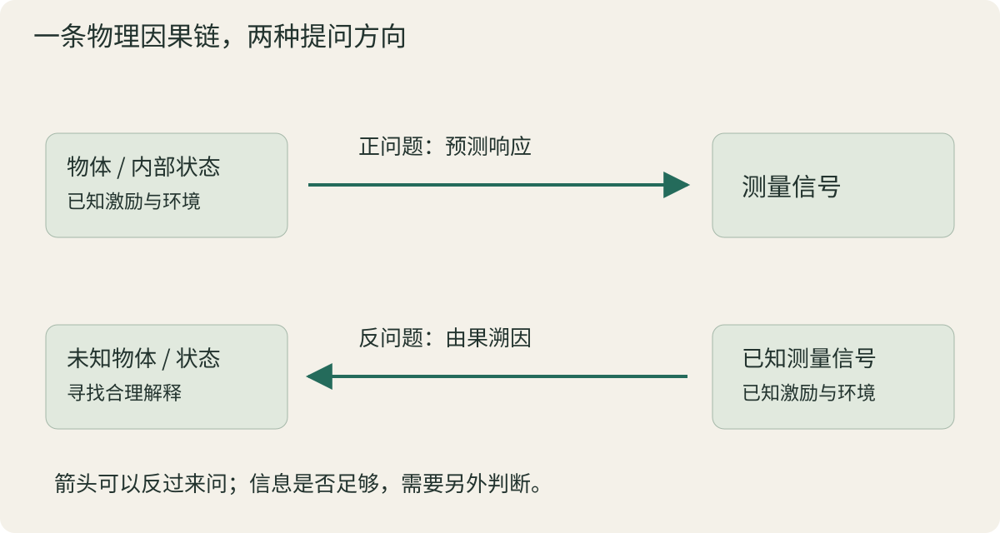
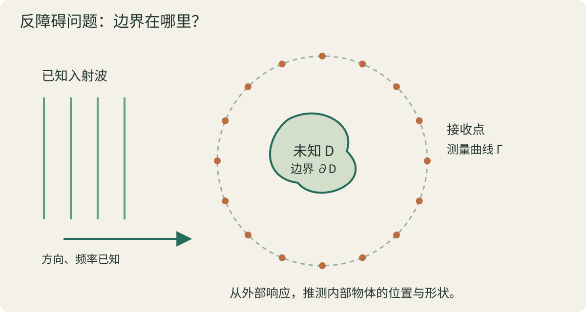
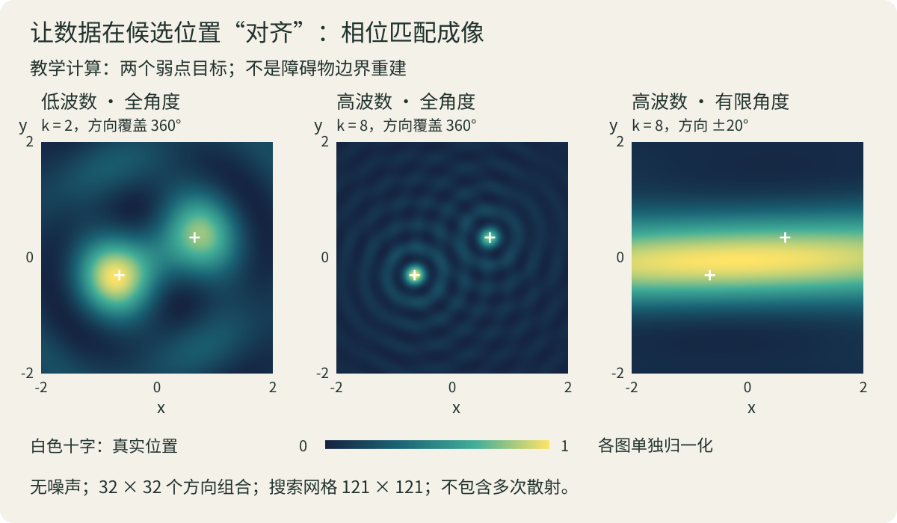

买西瓜时，有人会先托一托，再敲几下，把耳朵凑近听；往壶里接水时，即使没有一直盯着水面，也可能从声音的变化猜到快满了。

我们并没有直接看见瓜瓤，也没有时时测量水位，却在根据外部线索推测内部状态。这种思考方式有一个很贴切的名字：**反问题——由果溯因。**

上一篇文章讨论了[波遇到物体后怎样传播和散射](../post.html?slug=wave-scattering-notes)。这一篇把箭头反过来：如果我们只拿到了返回的信号，能不能知道前面有什么？能知道多少？又有多可信？

## 一、正问题与反问题：同一条因果链，两个提问方向

设想你在一个空房间里拍一下手。

如果知道房间的形状、墙面的材料、拍手的位置与声音，就可以尝试计算各个位置会听到什么。这是**正问题：知道系统和输入，预测它的响应。**

反过来，如果房间看不见，只能听到几个位置录下的回声，你想推测房间有多大、哪面墙在哪里，就是**反问题：根据响应，推测未知的系统。**

*图 1：反过来的是提问方向，不是让时间真的倒流。反问题通常仍需要一个描述“原因如何产生结果”的正问题模型。*

数学上，可以把这条关系简写成

$$
y=\mathcal F(m).
$$

$m$ 表示想了解的东西，例如物体的形状、地下的波速分布；$y$ 是测量信号；$\mathcal F$ 表示从物体到信号的物理过程。这里把已知的激励、传感器位置等条件都包含在模型里。

- 正问题：给定 $m$，计算 $y$。
- 反问题：给定 $y$，寻找能够解释它的 $m$。

这不是简单地把一个等号左右交换。**物理过程可能把不同的原因压缩成相似的结果，也可能让某些细节在传播中变得极其微弱。** “知道怎么产生信号”与“能从信号中可靠地找回原因”，是两件不同的事。

## 二、生活里，我们早就在做反问题

### 1. 敲西瓜：听到的是振动，想知道的是内部

敲击让西瓜产生振动，瓜皮、瓜瓤和内部结构共同影响声音。我们根据音色、响度和声音持续的时间，试着判断内部状态，再把它与成熟程度联系起来。

但声音并不是一张“成熟度成绩单”。大小、品种、瓜皮厚度、握持方式、敲击位置和力度都会改变它。同样的声音，可能对应不同的西瓜；同一个西瓜，换一种敲法也可能听起来不同。

所以这是一种有条件、有经验成分的判断，而不是“某种声音一定对应某种成熟度”的可靠定律。它恰好提醒我们：**做反问题时，除了想知道的量，还要处理那些同样影响测量的其他因素。**

### 2. 听接水声：听见变化，估计水位

往壶或瓶子里接水时，水流冲击、气泡以及空气和容器的振动共同产生声音。随着水位变化，剩余空气空间、冲击位置等也在变化，声音因此可能发生有规律的改变。

对一些近似直筒的容器，水面上方的空气柱变短，相关共鸣音调往往会升高。但不能把这句话机械套到所有水壶上：细颈瓶、宽口杯和薄壁金属壶的主要振动机制可能不同，水流速度也会影响声音。

这里说的是**接水时判断水位**，不是根据烧水时的沸腾声判断温度。即使只讨论接水，熟悉一个容器后形成的经验，也不一定能直接迁移到另一个容器。

如果容器形状已知、流量比较稳定，声学线索就更容易解释；如果形状、流量和水位全都未知，判断就困难得多。实际研究也尝试从倒水声音中估计液体和容器的属性，见[相关研究](https://arxiv.org/abs/2411.11222)。

### 3. 顺着线索追问，而不是只凭一个现象下结论

维修人员听机器异响，想找到松动或磨损的位置；天文学家分析光谱，想了解遥远天体的成分。这些任务的共同点，不是都使用同一种算法，而是都需要问：

**我观察到的现象，究竟支持哪些解释？还能做什么测量，把这些解释区分开？**

## 三、工程中的反问题：把“猜”变成有依据的重建

| 应用 | 实际测量什么 | 希望知道什么 |
| --- | --- | --- |
| CT | 多个角度下穿过身体的 X 射线强度 | 内部的衰减系数分布，再据此形成断层图像 |
| 地质勘探 | 地表或井中接收的地震波信号 | 地层结构、波速分布及相关地下信息 |
| 雷达成像 | 发射电磁波后收到的回波 | 目标的位置、散射特征及可辨认的空间结构 |
| 超声无损探伤 | 波穿过材料或被缺陷散射后的信号 | 裂纹、孔洞等缺陷的位置和特征 |

### CT：一张切片不是直接拍出来的

普通照片给人一种直觉：图像是相机看到的东西。但 CT 切片来自多方向测量与计算重建，而不是一台相机直接拍到了身体内部的横截面。

在一个简化模型里，X 射线沿路径穿过材料，强度逐渐衰减。对测量作适当变换后，可以得到沿这条路径的衰减系数积分。只测一个方向，许多内部排列可能给出同样的总衰减；换不同角度测量，就能增加区分这些排列的线索。参见 [NIBIB 的 CT 科普介绍](https://www.nibib.nih.gov/science-education/science-topics/computed-tomography-ct)。

### 地质勘探、雷达和探伤：让波替我们探路

地下结构会改变地震波的到达时间和波形，因此研究者能根据地表记录反推地下信息。[USGS 的介绍](https://www.usgs.gov/publications/seismic-site-characterization-shear-wave-sh-reflection-and-refraction-methods)讨论了利用反射与折射测量估计近地表波速的方式。

雷达成像与超声探伤也依靠类似的链条：已知激励，记录响应，再结合传播模型解释数据。但“发现一个回波”不等于“已经知道完整形状”。定位、辨认多个目标、恢复边界细节，是难度不同的任务。

这些应用都属于反问题，却不完全属于同一种反散射模型。例如，上述基础 CT 模型主要讨论透射衰减；不能把它直接当成后文声波绕障碍物传播的模型。

## 四、为什么难：数据不一定足够，也不一定可靠

数学上，按照 Hadamard 的经典观点，一个问题要称为**适定**，需要满足三个要求：解存在、解唯一、解对数据连续依赖。第三条也常被称作稳定性。这里的说法必须放在指定的模型、允许的未知量范围以及衡量误差的方式中理解，不能脱离条件笼统判断。

### 1. 存在性：这些数据，真能由模型解释吗？

假设你只允许目标是一个圆，但测量来自一个带尖角的物体。即使仪器完全准确，也可能找不到一个圆恰好解释所有记录。

再比如测量本来就有噪声，各条记录可能彼此不完全相容。此时，强求一个模型同时精确满足每条记录，未必有解。

这并不意味着现实中的物体不存在。**“现实有一个物体”与“我们选定的数学模型能精确解释这些数据”不是同一回事。** 所以工程里常转而寻找误差范围内合理的解释。

### 2. 唯一性：会不会有不同原因，给出同样的结果？

如果只知道两个人的年龄之和是 60 岁，就无法分别确定他们的年龄。20 与 40、25 与 35，都能解释这个结果。不是计算能力不够，而是线索本身不足。

回波也有类似问题。在均匀介质的简单往返测距模型里，一个传感器测得的传播时间，主要约束目标距离；同一距离上可能有许多不同方位。增加其他位置的传感器，才有机会把候选位置缩小。

“更多数据”也要看是否带来了新的信息。把同一个位置、同一种条件下的测量重复一百次，可能降低随机噪声，却不一定补上缺失的观测方向。

### 3. 稳定性：数据只错一点，答案会不会差很多？

想象一张被严重模糊的照片：宽大的明暗块仍然看得出来，细密条纹却几乎消失了。两种细节很不相同的原图，经过模糊后，可能只剩下极小的差别。

如果这些差别已经小于测量误差，重建程序再试图把它们放大，就很容易同时放大噪声。得到一幅边缘锐利的图，并不等于那些边缘真的被数据支持。

连续依赖的直觉是：当数据误差趋于零，解的误差也应趋于零。对一个唯一可逆的模型，这可以写成

$$
y_j\longrightarrow y
\quad\Longrightarrow\quad
\mathcal F^{-1}(y_j)\longrightarrow\mathcal F^{-1}(y).
$$

这里不是在保证“数据误差减少一半，结果误差也减少一半”。连续性并不自动意味着容易计算、误差很小；实际误差放大的程度同样重要。

**反问题常常不适定，但不是所有反问题都不适定，也不是每个反问题都会同时失去上述三条性质。** 有些模型在足够丰富的理想数据下具有唯一性，实际重建仍可能对噪声十分敏感。

### 4. 如何应对：补充信息，也给答案划定边界

改善测量可以增加角度、频率和传感器覆盖；改善模型可以加入已知材料、尺寸范围或边界条件。还可以避免让算法为了追逐每一点噪声，生成过于复杂的答案。

这类做法常用“正则化”来概括。一种典型表达是

$$
m_\alpha\in\underset{m\in\mathcal A}{\operatorname{argmin}}
\left\{\|\mathcal F(m)-y^\delta\|^2+\alpha R(m)\right\}.
$$

不用被符号吓住：$\mathcal A$ 是允许考虑的候选范围，$y^\delta$ 是有误差的测量；第一项要求预测信号接近测量，第二项对我们认为不合理的候选增加代价，例如过度粗糙的形状；$\alpha$ 决定两者如何权衡。这个写法本身不保证一定存在唯一的最优解，还需要相应条件。

正则化不是凭空创造丢失的信息。约束太弱，可能把噪声当细节；约束太强，又可能把真实的小结构抹掉。可靠的结果需要把这些取舍说清楚。

## 五、回到波：什么是反障碍散射问题？

现在设想有一个看不见的物体。我们从已知位置发出波，在物体外面记录它造成的变化，希望找出物体的位置和形状。这就是一类**反障碍散射问题**。

“反障碍”侧重未知边界或几何形状；如果未知的是可穿透物体内部的声速、密度等分布，则属于另一类相关的反介质问题。两者可以联系起来，但不是同一个未知量。

*图 2：一个理想化的观测设置。图中画出了未知物体，是为了说明问题；实际反演时，算法拿到的是测量数据，而不是这条边界。*

### 1. 先写正问题：已知物体，波会怎样？

为了把重点放在形状上，下面只讨论二维、均匀背景中的标量声波模型。设未知障碍物占据区域 $D$，它的边界记为 $\partial D$，背景声速 $c$ 已知。假设边界足够光滑，外部区域连通。

取一个理想的**声软边界**：边界上的总声压扰动为零。它是一种明确的数学模型，并不是说真实物体一定由“柔软材料”制成，更不应与刚性声硬边界混淆。

已知声源产生入射场 $u^{\mathrm{inc}}$，物体带来的改变是散射场 $u^{\mathrm{sc}}$，于是总场为

$$
u=u^{\mathrm{inc}}+u^{\mathrm{sc}}.
$$

在时域里，一个因果散射模型可以写为

$$
\begin{cases}
\partial_t^2u^{\mathrm{sc}}-c^2\Delta u^{\mathrm{sc}}=0,
&x\in\mathbb R^2\setminus\overline D,\ t>0,\\
u^{\mathrm{sc}}=-u^{\mathrm{inc}},
&x\in\partial D,\ t>0,\\
u^{\mathrm{sc}}(x,0)=\partial_tu^{\mathrm{sc}}(x,0)=0.
\end{cases}
$$

这里假设激励在初始时刻之前尚未到达障碍物，并与初始条件相容；散射响应由激励产生，外部无穷远处不额外送入未知的波。$\Delta$ 表示对两个空间方向分别求二阶导数后相加。

第一行描述外部传播，第二行保证边界上“入射场与散射场相加为零”，第三行说明散射响应如何开始。加上已知激励和适当的因果传播要求，才是完整的正问题，而不只是孤零零的一条波动方程。

### 2. 如果只看一个频率，方程会怎样？

设时间变化采用 $\operatorname{Re}\{u(x)e^{-i\omega t}\}$，其中 $\omega$ 是角频率。把它代入波动方程，时间二阶导数变成乘以 $-\omega^2$，得到 Helmholtz 方程。定义波数 $k=\omega/c$。

以方向为 $d$ 的平面入射波为例，频域正问题是

$$
\begin{cases}
(\Delta+k^2)u^{\mathrm{sc}}=0,
&x\in\mathbb R^2\setminus\overline D,\\
u^{\mathrm{sc}}=-e^{ikd\cdot x},
&x\in\partial D,\\
\displaystyle\lim_{r\to\infty}\sqrt r\left(\partial_r u^{\mathrm{sc}}-iku^{\mathrm{sc}}\right)=0,
&r=|x|.
\end{cases}
$$

最后一行称为辐射条件，要求极限对观察方向一致。直观上，它选出向外传播的散射波，排除无穷远处凭空入射的波。这是二维写法，三维的相应因子是 $r$，不能直接混用。

### 3. 再把问题反过来：已知数据，寻找边界

设接收点位于障碍物外面的已知测量曲线 $\Gamma$ 上。对若干已知入射方向 $d_\ell$ 和波数 $k_q$，记录散射响应：

$$
y^\delta_{j\ell q}
=u_D^{\mathrm{sc}}(x_j;d_\ell,k_q)+\eta_{j\ell q},
\qquad x_j\in\Gamma.
$$

$\eta$ 表示测量误差；下标 $D$ 提醒我们，改变物体，就会改变预测响应。理想情况下，已知背景入射场可以从总场测量中扣除，得到散射数据。频域复数数据还包含相位信息；只有强度时，是信息不同的另一种反问题。

把所有测量组成一个数据集合，就可以简写成

$$
\mathcal F(D)\approx y^\delta,
\qquad\text{寻找 }D\text{ 的位置与边界 }\partial D.
$$

已知的是背景、激励、接收位置、边界类型和测量；未知的是物体几何。如果边界类型或背景介质也未知，那就增加了新的未知量，不能沿用同样的信息充分性假设。

“找到了一个解释数据的形状”还不等于“证明这就是唯一真实形状”。有限方向、有限频率、有限测点能支持怎样的唯一性和稳定性，需要具体分析。

## 六、数据怎样变成一幅图？先看一个可以复现的小实验

一种直观的成像思路是：在搜索区域里逐点试探。如果目标真的在这里，各个接收信号应有怎样的相位关系？把测量按这个假设对齐，能够相互增强的位置，就值得进一步关注。

下面不是手绘“效果图”，而是用明确的简化模型计算出的成像指标。但要先划清边界：**这是两个弱点散射体的教学实验，不是上面声软障碍物方程的完整边界重建，也不是我的论文实验结果。** 它只用于说明定位、波长和观测角度之间的关系。

### 1. 这幅图到底计算了什么？

在二维平面上放两个点目标，位置为 $z_1=(-0.65,-0.30)$、$z_2=(0.65,0.35)$，强度分别为 $a_1=1$、$a_2=0.8$。忽略目标之间的多次散射，并把公共比例因子吸收进强度，用一个单次散射的远场近似生成数据：

$$
y_{j\ell}=\sum_{n=1}^{2}a_n
e^{ik(d_\ell-\hat x_j)\cdot z_n}.
$$

$d_\ell$ 是入射传播方向，$\hat x_j$ 是远场观察方向。两个方向向量的差，决定了不同候选位置对应的相位。

在每个候选点 $z$ 上计算

$$
I(z)=\left|\frac{1}{N^2}
\sum_{j=1}^{N}\sum_{\ell=1}^{N}
y_{j\ell}e^{-ik(d_\ell-\hat x_j)\cdot z}\right|.
$$

可以把它理解为“把信号按候选点重新对齐后，看合起来有多强”。所有图都使用 $N=32$ 个入射方向与 $32$ 个观察方向，搜索范围为 $[-2,2]^2$，网格为 $121\times121$；数据不加噪声，各图分别按自身最大值归一化。

*图 3：可复现的教学计算。左：$k=2$、全角度；中：$k=8$、全角度；右：$k=8$、入射和观察方向均限制在 $-20^\circ$ 到 $20^\circ$。颜色越亮，归一化指标越高；白色十字只用于对照真实位置，不参与成像计算。坐标与波数使用一致的无量纲单位。*

### 2. 读图时，应该关注什么？

先比较左图和中图：波数增加意味着波长 $\lambda=2\pi/k$ 变短。在这个理想模型里，成像的亮斑更集中，两个目标的位置也更容易区分。

再比较中图和右图：保持波数与测量数量不变，只缩窄方向覆盖，亮区会沿某些方向拉长。**更多测量点与更丰富的角度信息，不是一回事。** 右图的模糊不是靠把显示图片放大就能解决的。

还要注意三件事：

- 亮斑的宽度不是目标的真实尺寸。这里的目标本来就被模型当成点。
- 指标图不是概率图。亮度 0.8 不代表“有 80% 的概率存在目标”。
- 这里没有噪声，也使用同一个模型生成和解释数据，因此只是理想化演示，不构成工程精度或抗噪声能力的验证。高频在现实中还可能面临更强衰减、建模误差和更高采样要求。

生成脚本可在[这里查看或下载](../../scripts/generate_inverse_demo.py)，运行需要 Python、NumPy 和 Pillow。把这些条件公开，是为了让读者知道一幅“成像结果”究竟建立在什么之上。

### 3. 从亮点到边界，还有一段路

如果希望恢复一个真正有大小、有边界的障碍物，通常还需要使用与它相符的正问题模型，考虑边界条件、多次散射，以及几何参数怎样影响数据。

一种思路是先用成像指标粗略定位，再调整候选形状，不断比较预测信号与实际测量。但具体算法可能依赖初始猜测、正则化和停止准则；误差小也不自动意味着恢复了所有真实细节。

因此，展示真实的障碍物重建时，除了“原图与重建图”，还应该交代：用了哪些波源和接收方向、多少频率、什么噪声水平、什么模型，以及误差如何衡量。只有这些条件说清楚，图像的清晰程度才有可比较的意义。

## 七、反问题教会我们的，不只是成像

从敲西瓜到看 CT，从听水声到寻找地下结构，我们一直在用看得见、听得到的结果，推测无法直接观察的原因。

数学并不是给这种推测套上一层复杂符号，而是帮助我们区分：哪些信息确实来自数据，哪些来自经验或假设，哪些细节目前还无法可靠判断。

一个好的反问题结果，不只是画出一幅漂亮的图，而是能够回答：**这幅图为什么值得相信？换一组测量、加一点误差，它还站得住吗？**

---

### 延伸阅读与说明

- [NIBIB：Computed Tomography](https://www.nibib.nih.gov/science-education/science-topics/computed-tomography-ct)：CT 的测量与图像形成。
- [USGS：地震波反射与折射测量](https://www.usgs.gov/publications/seismic-site-characterization-shear-wave-sh-reflection-and-refraction-methods)：地下波速信息的获取。
- [DLR：合成孔径雷达教程](https://elib.dlr.de/82313/1/SAR-Tutorial-March-2013.pdf)：雷达成像的背景。
- [Cambridge：反问题讲义](https://www.damtp.cam.ac.uk/research/cia/files/teaching/Inverse_Problems_2020/LectureNotes2020.pdf)：适定性与正则化。
- [The Sound of Water](https://arxiv.org/abs/2411.11222)：从倒水声音推断物理属性的研究。
