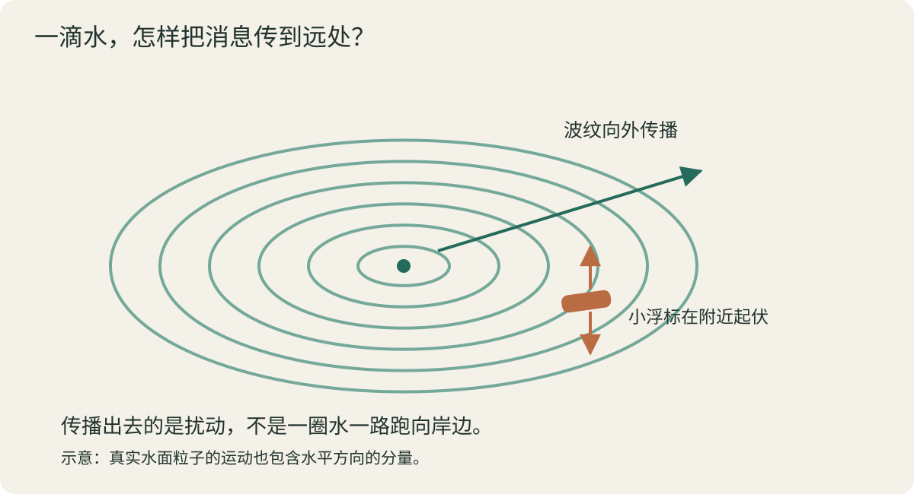
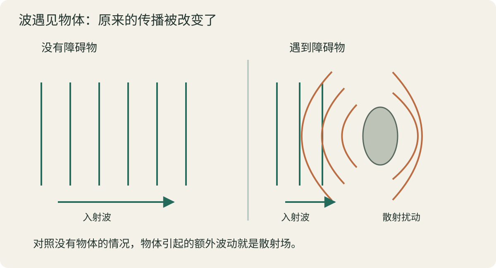
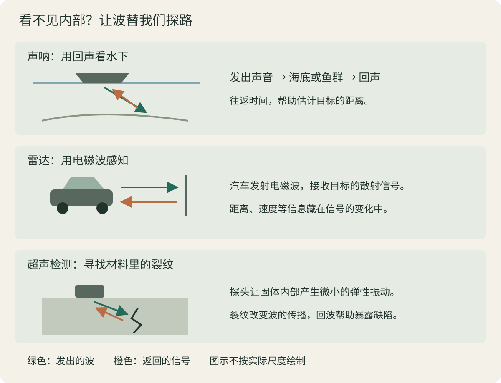
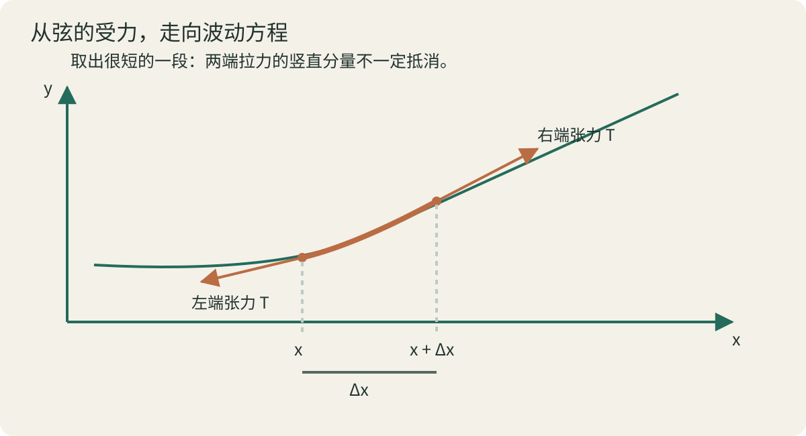
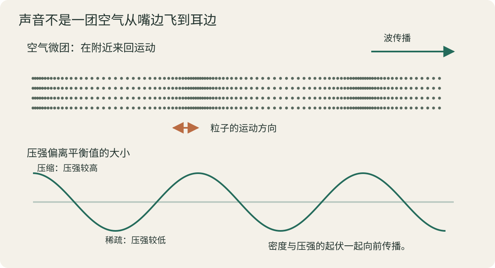
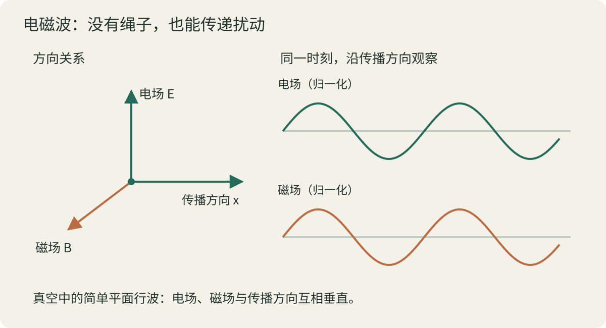

一滴雨落进水洼，水面向外推开一圈圈涟漪。如果涟漪碰到一块露出水面的石头，接下来会怎样？

它不会像一颗小球那样，只沿着一条路线撞过去再弹回来。石头前面会出现返回的波，边缘附近的波纹会弯曲，石头后面也未必完全平静。原本简单的波纹，变成了一幅更复杂的图案。

这就是我们认识**波散射**的起点：波在传播途中遇到物体，或进入性质不同的材料，原来的传播状态因此发生改变。

这件事离生活很近。山谷里的回声、汽车雷达收到的信号、超声探头探测到的内部结构，都与波和物体的相遇有关。我们看不见许多波，却能利用它们认识看不见的地方。

本文沿着三条台阶往下走：先观察日常现象，再看看工程师怎样使用这些现象，最后亲手把“波在动”写成数学方程。第三部分会用到一点微积分，每个符号都会先解释；如果暂时跳过运算，仍可以顺着文字读懂物理思路。

## 一、先从一盆水说起：究竟是什么在向前走？

### 1. 波纹走远了，水也跟着走远了吗？

找一个浅水盘，等水面平静后，用手指轻点一下水面。观察波纹，再观察漂在附近的一小片软木。

你会发现：波纹明显向外传播，软木主要在附近晃动，并没有像坐上传送带一样，随着某一圈波纹一路跑到盘边。

*图 1：可以在家观察的水波。箭头表示波纹向外传播；软木的局部运动只作示意，真实水体的运动还可能包含水平分量和缓慢漂移。*

可以把这个过程想成体育场里的人浪。每个人站起来、坐下，动作传给旁边的人；整圈“浪”绕着看台跑，但观众并没有绕着看台奔跑。

水波并不是人浪，水里的相互作用当然更复杂。不过这个比喻抓住了一点：**波传播的是某种扰动，伴随着能量传递，不要求介质中的每一份物质都跟着波一路前进。**

这里的“介质”，就是承载这种运动的材料，例如水、空气或者一根绳子。小幅水波中的水质点往往沿近似闭合的轨迹运动；风、流动、波浪破碎等因素也能带来净输运。所以“波传播”与“物质搬运”需要区分，却不能把“水永远不移动”当成结论。

### 2. 三个熟悉的词：振幅、波长和频率

观察一列比较规则的波，我们可以问三个很朴素的问题。

- **起伏有多大？** 这对应振幅。对绳子来说，可以看它偏离平衡位置有多远。
- **相邻两座波峰隔多远？** 这叫波长，通常用 $\lambda$ 表示。
- **固定看一个位置，一秒钟经历多少次完整起伏？** 这叫频率，用 $f$ 表示。

对于这样一列规则的行进波，一个周期里波形前进一个波长，因此它的传播速度满足

$$
c=\lambda f.
$$

注意：这里的 $c$ 是波形前进的速度，不是绳子上某一点上下运动的速度。后面推导方程时，这个区别还会出现。

### 3. 放进一块石头，就有了散射

现在让水波遇到一块固定障碍物。理解散射最方便的办法，是比较两种情形：**没有障碍物时会有什么波，有了障碍物后又有什么波。**

*图 2：散射的核心是比较。左图表示没有物体时的背景波；右图表示物体会引起返回、侧向和绕到背后的波动。曲线用于说明方向，不是计算得到的精确波峰，也不表示各方向散射强度相同。*

把这件事放进动画里，就更容易看清了。下面的圆柱散射动画并排展示了三幅图：左边是没有障碍物时的**入射场**，中间是物体引起的额外变化——**散射场**，右边是两者叠加后的**总场**。先盯住右图中圆形边界附近的条纹，再与左图对比：原来规则的波动图案，被物体改变了。

<figure id="cylinder-point-source">
  <video controls playsinline loop preload="metadata" poster="../../assets/scattering-intro/point-source-poster.png" aria-label="圆柱散射动画：入射场、散射场与总场的对比">
    <source src="../../assets/scattering-intro/cylinder_point_source.mp4" type="video/mp4">
    你的浏览器不支持内嵌视频，请使用下方链接打开 MP4。
  </video>
  <figcaption>动画 1：圆柱散射的波场变化。点击播放。</figcaption>
</figure>

这里先把“场”理解为每个位置上的波动量即可。动画帮助我们看清“原来的波 + 物体带来的改变 = 实际的波”这一关系；它并不是开头那盆水的实拍，也不意味着所有波、所有障碍物都会产生同样的图案。

波碰到一面足够大、足够平整的墙，明显的返回现象通常叫**反射**。波在障碍物边缘或者开口附近向原本不容易到达的区域展开，常用**衍射**来描述。真实场景中，这些特征可以同时出现；研究一个物体怎样改变周围的波时，我们常把它们放进散射问题里一起考虑。

“散射”也不等于“把波均匀地散向四面八方”。一个物体可能主要把波送回去，也可能主要向前或向侧面重新分配波的能量。方向、强弱和时序，都可能携带物体的信息。

这件事和波长有密切关系。障碍物与波长相比有多大，会影响波能否明显绕过它，以及哪些细节容易影响波形。因此，门外的声音能绕进来，而可见光在相同尺寸的门框附近通常留下清晰阴影。不是光没有波动性，而是可见光的波长相对于门框太短，边缘的绕行效果不容易在日常尺度上看清。

还要分清另一个词：**干涉**描述几列波叠加时怎样增强或抵消。它并不一定需要障碍物；散射产生的波与原来的波相遇时，也会发生干涉。

## 二、工程里，波为什么要去“碰一下”物体？

如果波会被物体改变，那么接收到这些变化，就可能知道物体在哪里、内部有什么结构。许多探测设备的共同思路都是：发出一段已知信号，等待环境的回应。

### 1. 声波：用回声丈量看不见的水下

在空旷的山谷喊一声，过一会儿听到回应，你很容易理解“声音走出去，又走回来”这件事。主动声呐把这一过程搬到了水下：换能器发出声脉冲，海底或目标把其中一部分声波返回，接收器记录它。

如果声速近似为常数 $c$，目标近似静止，发射和接收又在同一位置，那么由单次往返时间 $\Delta t$ 可以估算距离：

$$
d\approx\frac{c\Delta t}{2}.
$$

除以二，是因为信号走了一个来回。实际海水中的声速会随温度、盐度和压力改变，传播路线也未必是一条直线，所以真实设备需要更细致的模型。[NOAA 的声呐介绍](https://oceanservice.noaa.gov/facts/sonar.html)解释了主动发声和被动监听的区别；这里说的是主动声呐。

医学超声也利用声波与组织结构的相互作用。探头接收不同位置返回的信号，再由算法组织成图像。这里不是有一束“能拍照片的光”穿进身体，而是把声学响应转换成了我们可以观看的图像。

### 2. 电磁波：汽车怎样知道前面有车？

汽车雷达发出电磁波，前方车辆会改变电磁场，其中一部分信号回到接收器。设备利用返回信号的时间、相位、频率等信息估计距离和运动状态。不同雷达的具体实现不同，不能把每一种都简单理解成直接按秒表测回声，但“发射—相互作用—接收”这条线索是相通的。

手机信号和 Wi-Fi 也是电磁波。房间里的墙面、家具和人体会反射、透射、吸收或散射它们。到达手机的信号可能沿着多条路线而来，再相互叠加。这是为什么在室内移动一小段距离，接收情况也可能变化的一个原因。

### 3. 弹性波：不拆开金属，也能发现内部裂纹

想象敲一下桌面：振动能沿着桌子传到另一处。固体能传递压缩，也能传递剪切，也就是相邻部分的错动，因此固体中的波比空气里的声波更丰富。

工业检测中，可以让超声探头把振动送入金属。波遇到内部裂纹、孔洞或材料界面，会发生反射和散射；返回信号的变化可以帮助判断内部是否存在缺陷。这类检测的吸引力在于：我们希望了解里面的结构，却不必先把零件切开。

*图 3：三种波，三种场景。绿色箭头表示发出信号，橙色箭头表示返回信号；路线只作示意，真实传播通常更加复杂。金属中的超声本身就是一种弹性波，这些分类并非完全互斥。*

三种应用里的“波”不同，接收的量也不同：声波常关注压力变化，电磁波关注电场和磁场，弹性波关注固体的位移与受力。但它们都需要先回答同一个问题：**波为什么能传播，又会怎样响应它遇到的东西？**

接下来，我们从最容易看见的一根弦开始。

## 三、从看得见的振动，到可以计算的方程

### 1. 弦振动：把一小段弦的受力写清楚

轻轻拨一下绷紧的琴弦，或者晃动一根拉紧的细绳，就能看到形状沿着它传播。现在暂时把琴箱、空气阻力等因素放在一边，只研究一根理想的弦。

这个模型有几项约定：弦的粗细和材料均匀，拉力近似不变，弦足够柔软而且坡度很小；先忽略重力引起的下垂以及阻力。这些约定告诉我们，下面的方程适合描述怎样的实验，而不是所有情况下都精确成立。

**第一步：确定要记录什么。**

用 $x$ 标记弦在平衡位置上的坐标，用 $t$ 表示时间，用 $y(x,t)$ 表示弦上这一点相对于平衡位置的上下位移。

这里为什么要同时写 $x$ 和 $t$？因为我们既想知道“一根弦在这一刻是什么形状”，也想知道“同一个位置随后怎样运动”。

记号 $\partial y/\partial x$ 表示固定某个时刻，弦的位移随位置怎样变化，也就是弦的坡度；$\partial^2y/\partial t^2$ 表示固定位置上的上下加速度。它们分别把“形状”和“运动”写成了可以比较的量。

**第二步：截取一小段弦。**

取从 $x$ 到 $x+\Delta x$ 的一小段。设每单位长度的质量为 $\mu$，那么在小坡度近似下，这一小段的质量是

$$
\Delta m\approx\mu\Delta x.
$$

它受到左右两边弦的拉力，记拉力大小为 $T$。拉力方向沿着弦的切线，两端都向这小段弦的外侧拉。

*图 4：把一整根弦缩小成一个受力问题。橙色是选中的小段与两端拉力，绿色箭头表示坐标方向。坡度被放大以便看清，推导实际采用的是小坡度近似。*

**第三步：算它受到的竖直合力。**

如果两端坡度不同，两股拉力的竖直分量就不能完全抵消。设两端切线与水平方向的夹角分别为 $\theta_L$、$\theta_R$，竖直合力为

$$
F_y=T\sin\theta_R-T\sin\theta_L.
$$

由于坡度很小，$\sin\theta\approx\tan\theta$，而切线的斜率就是 $\partial y/\partial x$，于是

$$
F_y\approx T\left[
\frac{\partial y}{\partial x}(x+\Delta x,t)
-\frac{\partial y}{\partial x}(x,t)
\right].
$$

这个式子的意思很直白：**右端的向上拉动与左端的向下拉动相减，得到这一小段真正受到的竖直合力。**

**第四步：使用牛顿第二定律。**

高中物理里的“力等于质量乘加速度”现在写成

$$
\mu\Delta x\frac{\partial^2y}{\partial t^2}
\approx T\left[
\frac{\partial y}{\partial x}(x+\Delta x,t)
-\frac{\partial y}{\partial x}(x,t)
\right].
$$

两边除以 $\Delta x$，再让所取的小段越来越短。右边“坡度之差除以距离”的极限，就是坡度随位置的变化率，记作 $\partial^2y/\partial x^2$。这样得到

$$
\mu\frac{\partial^2y}{\partial t^2}
=T\frac{\partial^2y}{\partial x^2}.
$$

整理后，就是一维弦振动的波动方程：

$$
\boxed{
\frac{\partial^2y}{\partial t^2}
=c^2\frac{\partial^2y}{\partial x^2},
\qquad c=\sqrt{\frac{T}{\mu}}.
}
$$

**第五步：把方程读回物理。**

左边描述这一点怎样加速，右边描述周围的弦弯成什么样。弦的局部弯曲造成不平衡的拉力，拉力改变运动；这个变化又影响邻近的位置。

弦拉得更紧，$T$ 更大，扰动传得更快；在相同拉力下，单位长度更重，$\mu$ 更大，扰动传得更慢。传播速度来自材料和受力，而不是凭空加进公式的数字。

为什么这里的 $c$ 确实是波速？可以试一个向右移动、形状不变的波包：

$$
y(x,t)=F(x-ct).
$$

保持 $x-ct$ 不变，就相当于追着波包上的同一个形状特征走：时间增加 $\Delta t$，它的位置增加 $c\Delta t$。再对这个表达式求导，会发现 $y_{tt}=c^2F''$、$y_{xx}=F''$，恰好满足上面的方程。

到这里，模型完成了一次往返：从实验中的绳子出发，用受力得到方程，再由方程解释波怎样移动。弦波的标准推导也可参看 [OpenStax 的弦上波速一节](https://openstax.org/books/university-physics-volume-1/pages/16-3-wave-speed-on-a-stretched-string)。

**第六步：方程之外，还要告诉它“怎样开始”和“边缘在哪里”。**

同一根弦，可以被轻拨，也可以被持续摇动；两端可以固定，也可以有一端自由。这些条件不同，产生的波就不同。

如果长度为 $L$ 的弦两端固定，需要写上

$$
y(0,t)=0,\qquad y(L,t)=0.
$$

还要给出最初的形状 $y(x,0)$ 和最初的运动速度 $y_t(x,0)$。这些条件与波动方程放在一起，才构成一个可以求解的具体问题。

散射也在这里自然出现：让两段粗细不同的弦接在一起，波走到连接处，通常会分成返回的一部分和继续前进的一部分。连接处既不能把弦扯断，两侧的拉力也要协调；为了同时满足这些要求，原来的波形就需要发生改变。

### 2. 声波：空气为什么能把一句话送出去？

说话时，声带让附近空气发生微小振动。你不需要把同一团空气一路吹进对方耳朵：前面的空气稍微压紧后，会推动相邻空气；压缩与舒张依次传开，最终使对方的鼓膜振动。

这里还有一个容易被波形图误导的地方。声波经常被画成一条上下起伏的曲线，但在空气中的普通声波里，空气的微小振动主要沿传播方向来回进行。曲线的“高低”通常表示压力的增减，**并不表示空气真的沿着曲线蛇形前进**。

*图 5：上面画空气的疏密，下面画同一时刻的压力变化。点阵是概念示意，没有画分子的随机热运动；压力曲线的峰谷不代表空气的上下位置。*

我们可以沿用刚才的办法，只把“绳子小段”换成“一小段空气”。考虑一根截面积为 $A$ 的直管，空气原本均匀、静止，扰动很小，先忽略黏性损耗。

**第一步：体积变化来自两端位移的差。**

用 $\xi(x,t)$ 表示空气相对于平衡位置沿管道的微小位移。原来长度为 $\Delta x$ 的空气小段，左右端位移分别为 $\xi(x,t)$ 和 $\xi(x+\Delta x,t)$。它的体积变化近似为

$$
\Delta V=A\left[\xi(x+\Delta x,t)-\xi(x,t)\right].
$$

除以原体积 $V_0=A\Delta x$，取小段极限，有

$$
\frac{\Delta V}{V_0}\approx\frac{\partial\xi}{\partial x}.
$$

如果右端比左端多向右移动一点，空气被拉开，体积增加；反过来，空气被压缩。

**第二步：空气越被压紧，压力越高。**

设静止时压力为 $p_0$，额外的微小压力变化为 $p'(x,t)$。小幅压缩时可以写成

$$
p'=-K\frac{\Delta V}{V_0}
\approx-K\frac{\partial\xi}{\partial x}.
$$

$K$ 表示材料抵抗体积变化的能力，叫体积弹性模量。负号保证了：体积减小，压力增加。普通声学近似里，一次压缩与舒张期间的热交换常可忽略，因此使用相应的近似绝热弹性模量。

**第三步：左右压力不一样，空气就会加速。**

左侧压力把小段向右推，右侧压力把它向左推。两侧静止压力相互抵消，合力近似为

$$
F_x=A\left[p'(x,t)-p'(x+\Delta x,t)\right]
\approx-A\Delta x\frac{\partial p'}{\partial x}.
$$

设静止密度为 $\rho_0$，小段质量近似为 $\rho_0A\Delta x$。再次使用牛顿第二定律并约去共同因子：

$$
\rho_0\frac{\partial^2\xi}{\partial t^2}
=-\frac{\partial p'}{\partial x}.
$$

**第四步：把“压缩产生压力”和“压力推动空气”连起来。**

将 $p'=-K\xi_x$ 代入，假设 $K$、$\rho_0$ 为常数，就得到

$$
\frac{\partial^2\xi}{\partial t^2}
=\frac{K}{\rho_0}\frac{\partial^2\xi}{\partial x^2}.
$$

压力变化本身也满足同样形式的方程。因为对位移方程再求一次空间导数，并乘以 $-K$，两边就分别变成 $p'_{tt}$ 和 $(K/\rho_0)p'_{xx}$：

$$
\boxed{
\frac{\partial^2p'}{\partial t^2}
=c^2\frac{\partial^2p'}{\partial x^2},
\qquad c=\sqrt{\frac{K}{\rho_0}}.
}
$$

形式与弦的方程相似，但含义不同：弦里是拉力与质量的配合，空气里是压缩带来的压力恢复与惯性的配合。比较不同材料时必须同时看 $K$ 和 $\rho_0$，不能单凭“更重”或“更硬”就判断声速。

在约 $20^\circ\mathrm{C}$ 的空气中，声速约为每秒 $343$ 米。所以远处放烟花时，我们先看见亮光，稍后才听到声音：两种信号同时出发，却以很不相同的速度抵达。[OpenStax 的声速一节](https://openstax.org/books/university-physics-volume-1/pages/17-2-speed-of-sound)给出了介质、温度和声速之间的关系。

声音遇到墙面时，空气的运动不能继续像自由传播那样穿过一堵理想刚性墙。满足墙面约束需要加入返回的波，于是产生反射；遇到可振动、可透声的材料，则需要同时考虑材料的响应。声散射问题就在“空气的方程”与“物体表面的要求”之间建立联系。

### 3. 电磁波：没有空气，为什么仍能传来光？

把空气抽走，普通空气声波就失去了载体。但阳光能够穿过近乎真空的太空来到地球，航天器也能用无线电与地面通信。

这说明，电磁波不是另一种空气振动。它变化的是**电场和磁场**：电场描述电荷会受到怎样的电作用，磁场描述磁作用。我们虽然不直接看见无线电波，却能用天线中的电荷运动把它转换为电信号。

“光是一种电磁波”并非一开始就显而易见。麦克斯韦把电和磁的规律联系起来后，方程给出了传播的波，而且预测的速度与光速相符。这使光学与电磁学走到了一起。可见光、无线电波、微波都属于电磁波家族，区别之一在于频率和波长。[NASA 的电磁波谱介绍](https://science.nasa.gov/ems/)提供了这张家族地图。

下面只看最简单的情形：真空中、没有电荷和电流的区域，一列沿 $x$ 方向传播的平面波。取电场沿 $y$ 方向、磁场沿 $z$ 方向，把相应分量分别记为 $E(x,t)$ 和 $B(x,t)$。

*图 6：左侧说明方向关系，右侧分别画电场和磁场在同一时刻随位置的变化。两条曲线采用各自的归一化刻度，不比较数值大小；它们不是空间里两根真实起伏的绳子。*

**第一步：从电磁学的两条规律出发。**

一条是法拉第电磁感应定律：磁场随时间变化，与周围电场的分布相关。另一条是安培—麦克斯韦定律：磁场的分布不仅与电流有关，也与电场随时间的变化有关。

这里是在使用实验总结并由麦克斯韦完善的电磁规律，不能仅靠弦的受力类比把它们推出来。在上述方向约定下，这两条规律可以写成

$$
\frac{\partial E}{\partial x}=-\frac{\partial B}{\partial t},
\qquad
\frac{\partial B}{\partial x}=-\mu_0\varepsilon_0\frac{\partial E}{\partial t}.
$$

$\varepsilon_0$、$\mu_0$ 是描述真空电磁性质的常数。两个式子告诉我们：电场和磁场的空间变化与时间变化相互约束。“变化的电场与磁场相互联系”是有用的直觉，但并不是两种场轮流凭空制造能量；波携带的能量来自最初的源。

**第二步：消去磁场，只看电场怎样变化。**

对第一个式子再求一次 $x$ 导数，再使用第二个式子：

$$
\frac{\partial^2E}{\partial x^2}
=-\frac{\partial}{\partial t}\left(\frac{\partial B}{\partial x}\right)
=\mu_0\varepsilon_0\frac{\partial^2E}{\partial t^2}.
$$

整理后得到

$$
\boxed{
\frac{\partial^2E}{\partial t^2}
=c_0^2\frac{\partial^2E}{\partial x^2},
\qquad c_0=\frac{1}{\sqrt{\mu_0\varepsilon_0}}.
}
$$

磁场 $B$ 也满足同样形式的波动方程。这里 $c_0$ 就是真空光速，约为每秒 $3\times10^8$ 米。对这一向前传播的简单平面波，电场、磁场的变化同相，方向与传播方向相互垂直；更一般的电磁场不能都用这幅简单图景概括。推导背景见 [OpenStax 的麦克斯韦方程与电磁波一节](https://openstax.org/books/university-physics-volume-2/pages/16-1-maxwells-equations-and-electromagnetic-waves)。

这就是“看不见的波”很神奇的地方：它不需要靠空气分子接力，却仍能携带能量和信息。而当它遇到物体，物体中的电荷和电流会作出响应，原来的电磁场便被改变，形成反射、透射和散射等现象。雷达与无线通信正是利用或应对这些变化。

### 4. 从传播方程回到散射：还缺哪一块拼图？

我们现在有了三个外形相近的波动方程，但它们描述的量不同：

| 场景 | 变化的量 | 为什么能传播 |
| --- | --- | --- |
| 绷紧的弦 | 上下位移 $y$ | 拉力与弦的惯性相互配合 |
| 空气中的声波 | 压力变化 $p'$，或空气位移 $\xi$ | 空气的压缩恢复与惯性相互配合 |
| 真空中的电磁波 | 电场 $E$、磁场 $B$ | 电场与磁场满足耦合的电磁规律 |

一个提醒：开头的水波帮我们建立直觉，但真实水面波还涉及重力、表面张力和水深，波速也可能随波长变化；固体中的弹性波则有不同的振动方式和传播速度。不能把这里最简单的一维方程直接当成所有波的完整模型。

要从“波怎么传播”走到“波怎么散射”，还需要告诉数学：物体在哪里，里面和外面是什么材料，表面允许怎样运动，以及怎样发出最初的波。时域问题还要说明初始状态；如果模拟无限空间，计算区域的外缘也要允许波向外离开，不能凭空制造一面反射墙。

对于小振幅、线性的模型，我们经常把结果写成

$$
u_{\mathrm{total}}
=u_{\mathrm{incident}}+u_{\mathrm{scattered}}.
$$

这里的 $u$ 只是我们所观察的波动量的统称：可以是压力，也可以代表位移或电磁场分量。三个词分别表示实际的总波、没有目标物体时的背景入射波，以及物体带来的改变。

这是一种方便比较的分解，不是说实验里能拿出三种不同的“波物质”。我们真正测到的是总的响应，而散射场帮助我们把物体的影响从背景中分离出来。

再看最初那块水里的石头：它不是额外制造了一个神秘的现象，只是让波必须同时遵守新的空间约束和物理规律。水面上的复杂纹路、山谷中的回声、雷达里的返回信号，都是这件事在不同材料、不同尺度上的表现。

认识散射的第一步，不必从求解一个很大的方程组开始。先观察一圈波纹如何走向障碍物，再追问：**哪里在动，什么在推动它，遇到边界时必须满足什么？** 从这些问题出发，现象就能一步步走到数学。

---

### 延伸阅读与插图说明

- [OpenStax：弦上波速与受力推导](https://openstax.org/books/university-physics-volume-1/pages/16-3-wave-speed-on-a-stretched-string)。
- [OpenStax：不同介质中的声速](https://openstax.org/books/university-physics-volume-1/pages/17-2-speed-of-sound)。
- [OpenStax：麦克斯韦方程与电磁波](https://openstax.org/books/university-physics-volume-2/pages/16-1-maxwells-equations-and-electromagnetic-waves)。
- [NOAA：声呐怎样工作](https://oceanservice.noaa.gov/facts/sonar.html)。
- [NASA：电磁波谱](https://science.nasa.gov/ems/)。
